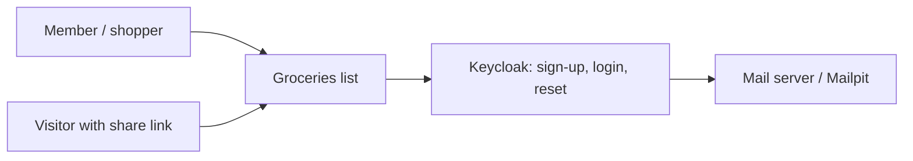

# 3. Context and Scope

## 3.1 Business context

| Partner | Input | Output |
|---|---|---|
| Member (browser) | list, item and membership commands; polling | lists, items, counts |
| Visitor with share link | link token, then sign-up/login | invitation page with list name only |
| Keycloak (IdP) | OIDC login/registration, reset, user admin API | ID token claims (`sub`, `email`, `email_verified`, `displayName`) |
| Mail server | reset mails from Keycloak | none |

## 3.2 Technical context

| Partner | Channel / protocol | Contract |
|---|---|---|
| Browser ↔ app | HTTPS, session cookie, CSRF header; REST `/api/v1/**` (JSON, problem+json) | `backend/openapi/groceries-v1.yaml` (generated, committed) |
| App → PostgreSQL | JDBC, Flyway | schema migrations |
| App ↔ Keycloak | OIDC (code + PKCE, confidential client), back-channel logout, admin REST API (user delete) with timeouts | realm template `backend/dev/keycloak/` |
| Keycloak → mail | SMTP | Mailpit locally |
