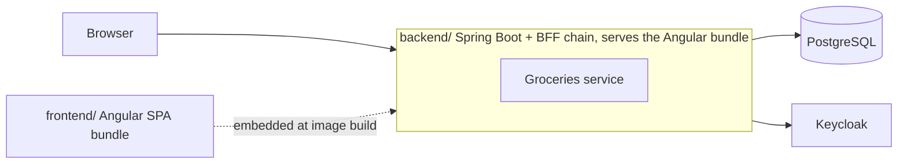

# 5. Building Block View

Structure inside components follows the baseline: [../baseline/05-building-block-view](../baseline/05-building-block-view/README.md).

## 5.1 Level 1: components

| Component | Responsibility | Folder |
|---|---|---|
| Backend | REST API, authorization on `Caller`, BFF session, persistence, serves the SPA | `backend/` |
| Frontend | Angular SPA: shell, lists, items, sharing, settings | `frontend/` |
| Keycloak theme | German login/registration/reset pages with design tokens | `backend/dev/keycloak/theme/` |

## 5.2 Level 2: backend

Base package `de.tantive.groceries`. Rings and adapters per [spring.md](../baseline/05-building-block-view/spring.md). Status: accounts, sessions and lists exist; the other cuts are planned and filled in per milestone (DOC-ARC-11).

| Feature cut (`application`) | Use cases (planned milestone) | Adapters |
|---|---|---|
| accounts | provision user at first login (M1), update display name (M6), delete account (M6) | `rest.v1`, `jpa`, `http` (Keycloak admin) |
| lists | **built (M2):** `CreateList`, `ListMyLists`, `GetList`, `RenameList`, `DeleteList`, `LeaveList` (one `@UseCase` each in `application.lists`; ports `ports.in.*UseCase`, commands/queries as records; outgoing ports `LoadListPort`, `SaveListPort`, `DeleteListPort`, `MembershipPort`, `ListSummaryPort`); domain `ShoppingList`, `ListName`, `Membership`, `ListSummary`, `ListNotFoundException`, `ListLimitReachedException` | `adapter.in.rest.v1` (`MyListsController`, `CreateListController`, `RenameListController`, `DeleteListController`, `LeaveListController`), `adapter.out.jpa` (`ListPersistenceAdapter`: JPA entity for creation, `JdbcClient` for member-scoped reads, locked read, rename, delete), `adapter.out.jdbc` (`MembershipJdbcAdapter`, `ListSummaryJdbcAdapter`) |
| items | **built (M3):** `ListItems`, `AddItem`, `UpdateItem` (text and/or done), `DeleteItem`, `ClearCheckedItems` (one `@UseCase` each in `application.items`; outgoing port `ItemPort`; domain `Item`, `ItemText`, `ItemNotFoundException`, `ItemLimitReachedException`) | `adapter.in.rest.v1` (`ListItemsController`, `AddItemController`, `UpdateItemController`, `DeleteItemController`, `ClearCheckedItemsController`), `adapter.out.jpa` (`ItemPersistenceAdapter`: JPA entity for creation, `JdbcClient` for the set-based updates; every write also moves `lists.revision`) |
| sharing | **built (M4, backend):** `GetShareLink` (creates the token on first use), `RenewShareLink`, `LookupInvitation` (public, no caller), `JoinList` (one `@UseCase` each in `application.sharing`; outgoing port `ShareLinkPort`, `MembershipPort.isMember`; domain `ShareToken`, `InvitedList`, `ShareLinkInvalidException`, `MemberLimitReachedException`) | `adapter.in.rest.v1` (`ShareLinkController`, `InvitationController`, `JoinListController`), `adapter.in.rest` (`PendingInvitation`, `SharingProperties`), `adapter.out.jdbc` (`ShareLinkJdbcAdapter`: the token column is not part of the list entity) |
| sync | read items with revision, read list summaries (M5; read side of M2/M3) | `rest.v1`, `jpa` |
| demo | seed two users and three lists (M0/M7) | `adapter.in.demo` |

### Lists API (M2, contract of `backend/openapi/groceries-v1.yaml`)

| Operation | Path | Result |
|---|---|---|
| `listMyLists` | `GET /api/v1/lists` | 200 `{lists:[{id,name,openCount,revision}]}`, at most 100, oldest membership first (BR-10, BR-12) |
| `createList` | `POST /api/v1/lists` | 201 + `Location`; 400 `VALIDATION_FAILED` (`errors[].field=name`, code `NAME_REQUIRED` / `NAME_TOO_LONG`); 409 `LIST_LIMIT_REACHED` |
| `getList` | `GET /api/v1/lists/{listId}` | 200; 404 `LIST_NOT_FOUND` |
| `renameList` | `PATCH /api/v1/lists/{listId}` | 200 with the list (last write wins, no `If-Match`, ADR 0007); 404 `LIST_NOT_FOUND` |
| `deleteList` | `DELETE /api/v1/lists/{listId}` | 204; 404 |
| `leaveList` | `DELETE /api/v1/lists/{listId}/members/me` | 204; the last member leaving deletes the list; 404 |

`openCount` is the number of unchecked items (M3): a correlated sub-select over the partial index `items_open_idx` inside the same single statement of `ListSummaryJdbcAdapter`.

### Items API (M3, contract of `backend/openapi/groceries-v1.yaml`)

All paths below `/api/v1/lists/{listId}/items`; a non-member or unknown list always answers 404 `LIST_NOT_FOUND` (same answer, BR-01). The server chooses ids; `Item = {id, text, done, createdAt, version}`.

| Operation | Path | Result |
|---|---|---|
| `listItems` | `GET …/items` | 200 `{items:[Item]}`, `createdAt` ascending (BR-09), at most 500 |
| `addItem` | `POST …/items` `{text}` | 201 + `Location`; 400 `VALIDATION_FAILED` (`errors[].field=text`, `TEXT_REQUIRED` / `TEXT_TOO_LONG`); 409 `ITEM_LIMIT_REACHED` (BR-12) |
| `updateItem` | `PATCH …/items/{itemId}` `{text?, done?}` | 200 with the item (idempotent set, no `If-Match`, ADR 0007); 400 if neither field (`CHANGE_REQUIRED`) or invalid text; 404 `ITEM_NOT_FOUND` if gone (FR-SYNC-02 AC3) |
| `deleteItem` | `DELETE …/items/{itemId}` | 204, also when the item is already gone (idempotent) |
| `clearCheckedItems` | `POST …/items/clear-checked` `{itemIds}` | 200 `{removed:n}`; deletes only the given ids that are still checked (FR-ITEM-05 AC4); more than 500 ids → 400 `TOO_MANY_ITEMS` |

## 5.3 Level 2: frontend

Rings per [angular.md](../baseline/05-building-block-view/angular.md). Built in M1-M3 (DOC-ARC-11); sharing and settings are planned for M4 and M6.

| Element | Content | Status |
|---|---|---|
| `src/platform` | runtime config, theme (`ColorScheme`), route title and focus, global error path, `PAGE_NAVIGATION` + `LOGIN_PATH` (whole-page navigation to the BFF login), `unauthenticatedInterceptor` (401 on `/api/` goes to the login), `untilAborted`, `TechnicalError` | built |
| `src/shared/ui` | `AppIcon` (self-hosted SVG icons), `WindowSize` (size classes), `Announcer`, `Snackbar` + `SnackbarHost`, `ConfirmDialogs`, `ValidatedField` (Signal Forms control), `EmptyState` | built |
| `features/session` | use cases `LoadCurrentUser`, `CheckSignedIn` (the probe for pages that show something to visitors: `GET /api/v1/me` marked `ANONYMOUS_ALLOWED`, so a 401 means "no" and does not go to the login), `Logout`; ports; HTTP adapter over the generated client; published API `provideSessionApi()` | built (adapter see implementation log) |
| `features/shell` | `AppShell` (app bar with the page's h1, drawer, ⋮ menu), `ShellStore` (sign-out), `authenticatedGuard`, empty lists page, settings placeholder | built |
| `features/lists` | use cases for my lists and the list commands, ports, HTTP adapter, storage adapter for the list opened last; published API `provideListsApi()` | built (M2) |
| `features/items` | domain `Item`, `parseItemText`, order (BR-09) and `focusTargetAfterChecking`; use cases `LoadItems`, `AddItem`, `EditItem`, `SetItemDone`, `DeleteItem`, `ClearCheckedItems`; HTTP adapter over the generated client (one list call returns all items, API-N1-01); published API `provideItemsApi()` | built (M3) |
| `features/shell` list page | `ItemsStore` (view state of the open list's items, route level), `ListItems` (add card, „Noch zu kaufen“, „Im Wagen“, collapsible on compact), `ItemDialog` (edit and delete), clear-checked confirmation. The page forwards the open count to `ListsStore.setOpenCount`, so the drawer follows without a second request (NG-STATE-03: stores never call each other) | built (M3) |
| `features/sharing` | domain `shareToken` (shape check, a malformed token is refused like an unknown one without a request), `ShareLink`, `JoinedList`, errors `ShareLinkInvalidError`, `JoinLimitReachedError` (members / lists), `ShareListNotFoundError`; use cases `LoadShareLink`, `RenewShareLink`, `LookupInvitation`, `RememberInvitation`, `JoinList`; HTTP adapter over the generated client (the token only ever in a request body); published API `provideSharingApi()` | built (M4) |
| `features/shell` sharing UI | `ShareActions` (share dialog, confirmed renewal for the dialog and the ⋮ menu), `ShareDialog` (read-only link field, „Link kopieren“, „Teilen …“ only where `navigator.share` exists, „Link erneuern“; the link is never an `href`), `JoinStore` + `JoinPage` for `/j/:token` and `/j/consume` (outside the shell and its guard; invitation page for visitors, invalid-link and limit pages as empty states, snackbar after joining) | built (M4) |
| `settings` | | planned (M6) |
