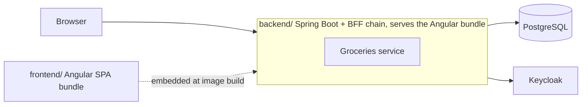

# 5. Building Block View

Structure inside components follows the baseline: [../baseline/05-building-block-view](../baseline/05-building-block-view/README.md).

## 5.1 Level 1: components

| Component | Responsibility | Folder |
|---|---|---|
| Backend | REST API, authorization on `Caller`, BFF session, persistence, serves the SPA | `backend/` |
| Frontend | Angular SPA: shell, lists, items, sharing, settings | `frontend/` |
| Keycloak theme | German login/registration/reset pages with design tokens | `backend/dev/keycloak/theme/` |

## 5.2 Level 2: backend

Base package `de.tantive.groceries`. Rings and adapters per [spring.md](../baseline/05-building-block-view/spring.md). Status: **planned**, filled in per milestone (DOC-ARC-11).

| Feature cut (`application`) | Use cases (planned milestone) | Adapters |
|---|---|---|
| accounts | provision user at first login (M1), update display name (M6), delete account (M6) | `rest.v1`, `jpa`, `http` (Keycloak admin) |
| lists | create, rename, delete, leave, list mine (M2) | `rest.v1`, `jpa` |
| items | add, edit, check, delete, clear checked (M3) | `rest.v1`, `jpa` |
| sharing | renew token, join, lookup invitation (M4) | `rest.v1`, `jpa` |
| sync | read items with revision, read list summaries (M5; read side of M2/M3) | `rest.v1`, `jpa` |
| demo | seed two users and three lists (M0/M7) | `adapter.in.demo` |

## 5.3 Level 2: frontend

Rings per [angular.md](../baseline/05-building-block-view/angular.md). Built in M1 (DOC-ARC-11); lists, items, sharing and settings are planned for M2-M6.

| Element | Content | Status |
|---|---|---|
| `src/platform` | runtime config, theme (`ColorScheme`), route title and focus, global error path, `PAGE_NAVIGATION` + `LOGIN_PATH` (whole-page navigation to the BFF login), `unauthenticatedInterceptor` (401 on `/api/` goes to the login), `untilAborted`, `TechnicalError` | built |
| `src/shared/ui` | `AppIcon` (self-hosted SVG icons), `WindowSize` (size classes), `Announcer`, `Snackbar` + `SnackbarHost`, `ConfirmDialogs`, `ValidatedField` (Signal Forms control), `EmptyState` | built |
| `features/session` | use cases `LoadCurrentUser`, `Logout`; ports; HTTP adapter over the generated client; published API `provideSessionApi()` | built (adapter see implementation log) |
| `features/shell` | `AppShell` (app bar with the page's h1, drawer, ⋮ menu), `ShellStore` (sign-out), `authenticatedGuard`, empty lists page, settings placeholder | built |
| `features/lists`, `items`, `sharing`, `settings` | | planned (M2-M6) |
