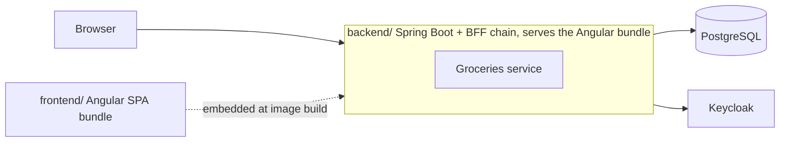

# 5. Building Block View

Structure inside components follows the baseline: [../baseline/05-building-block-view](../baseline/05-building-block-view/README.md).

## 5.1 Level 1: components

| Component | Responsibility | Folder |
|---|---|---|
| Backend | REST API, authorization on `Caller`, BFF session, persistence, serves the SPA | `backend/` |
| Frontend | Angular SPA: shell, lists, items, sharing, settings | `frontend/` |
| Keycloak theme | German login/registration/reset pages with design tokens | `backend/dev/keycloak/theme/` |

## 5.2 Level 2: backend

Base package `de.tantive.groceries`. Rings and adapters per [spring.md](../baseline/05-building-block-view/spring.md). Status: **planned**, filled in per milestone (DOC-ARC-11).

| Feature cut (`application`) | Use cases (planned milestone) | Adapters |
|---|---|---|
| accounts | provision user at first login (M1), update display name (M6), delete account (M6) | `rest.v1`, `jpa`, `http` (Keycloak admin) |
| lists | create, rename, delete, leave, list mine (M2) | `rest.v1`, `jpa` |
| items | add, edit, check, delete, clear checked (M3) | `rest.v1`, `jpa` |
| sharing | renew token, join, lookup invitation (M4) | `rest.v1`, `jpa` |
| sync | read items with revision, read list summaries (M5; read side of M2/M3) | `rest.v1`, `jpa` |
| demo | seed two users and three lists (M0/M7) | `adapter.in.demo` |

## 5.3 Level 2: frontend

Features under `frontend/src/features/` (`shell`, `lists`, `items`, `sharing`, `settings`) in rings per [angular.md](../baseline/05-building-block-view/angular.md); `src/platform` for HTTP, theme, runtime config, clock; `src/shared/ui` for snackbar, dialog, empty state components. Planned, filled per milestone.
