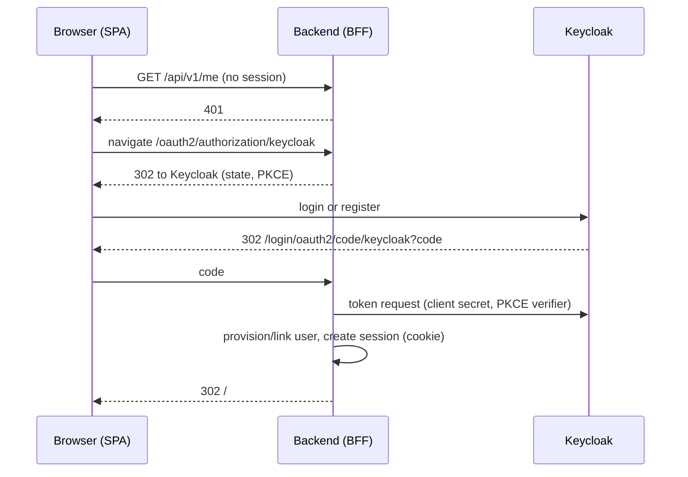
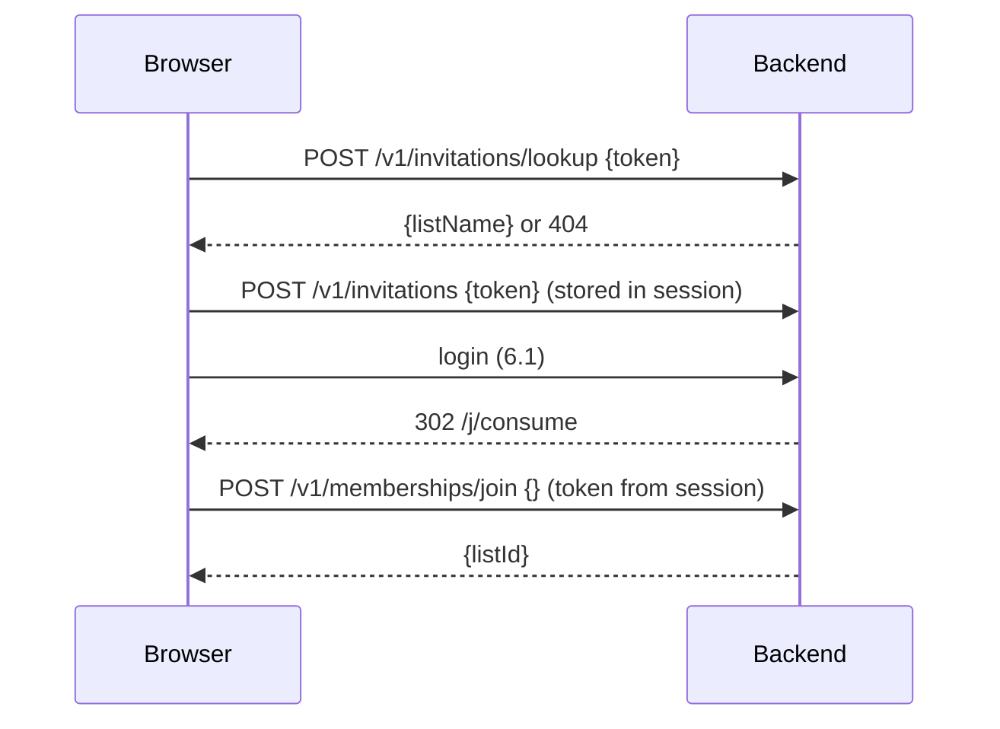

# 6. Runtime View

Status: planned; each scenario is confirmed per milestone.

## 6.1 Login (OIDC code flow through the BFF)

## 6.2 Join via share link

## 6.3 Polling

Open list: `GET /v1/lists/{id}/items` with `If-None-Match` every 5 s while visible; 304 reads one row. Drawer: `GET /v1/lists` every 30 s ([ADR 0006](../adr/0006-sync-by-polling-with-list-revision.md)).

## 6.4 Optimistic check/uncheck

Store patches the item, calls `PATCH /v1/lists/{id}/items/{itemId}`, rolls back and shows the error snackbar on failure (NG-STATE-10).
