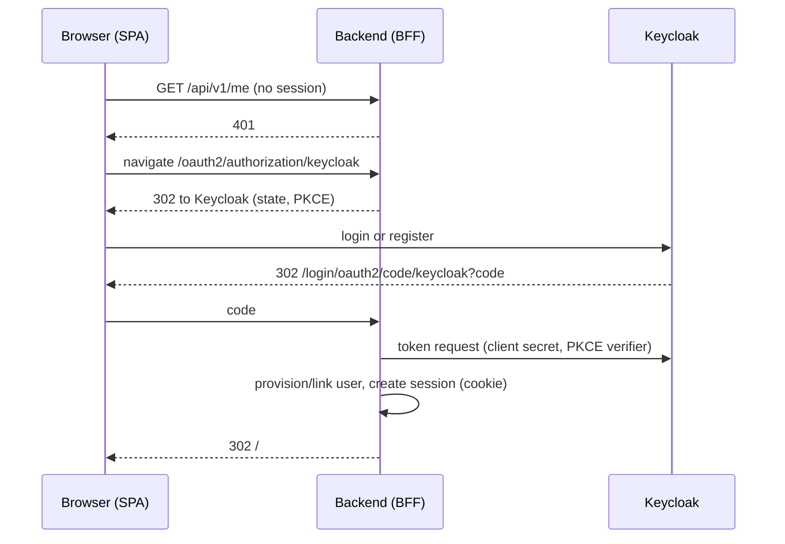
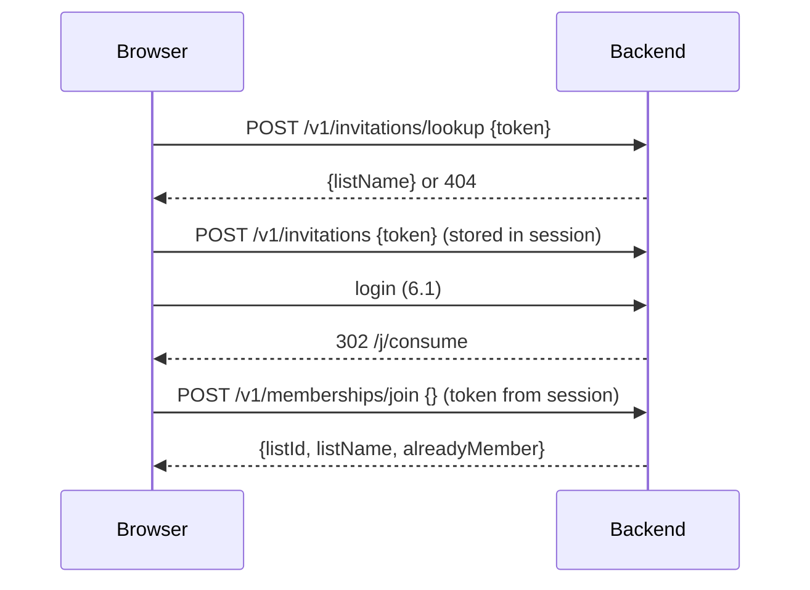

# 6. Runtime View

Status: 6.1 and 6.5 are built in the frontend as of M1 (the guard, the 401 interceptor and the sign-out); the rest is planned per milestone.

## 6.1 Login (OIDC code flow through the BFF)

## 6.2 Join via share link

Built in M4 (frontend): `/j/consume` comes first in `shell.routes.ts` and has the `authenticatedGuard`; `/j/:token` has none, because a visitor must see the invitation. `JoinStore.start` asks `CheckSignedIn` first (the 401 of the probe does not redirect, `ANONYMOUS_ALLOWED`): with a session it joins at once with the token in the request body and opens the list with `replaceUrl`, so the token leaves the address bar and the history; without one it looks the list name up and shows the invitation. „Konto erstellen und beitreten“ and „Anmelden“ first call `POST /v1/invitations`, then navigate the whole page to the login (`?prompt=create` for the sign-up). Invalid, limit and failure answers are pages of the same route; except a retryable failure, they take the secret off the address bar with `Location.replaceState('/')`. The token lives in the store's memory only, never in browser storage or a link. A snackbar behind a modal dialog is hidden from screen readers, so the share dialog repeats „Link kopiert“ and the renewal message in its own `role="status"` line.

Built in M4 (backend). `POST /v1/invitations` validates the token first (a wrong one answers the uniform `404 SHARE_LINK_INVALID` and opens **no** session), then keeps the token in a server-side session that lives 2 hours until the login has finished; the login success handler restores the normal idle time and redirects to `/j/consume` when a token is pending. The sign-up variant is `GET /oauth2/authorization/keycloak?prompt=create`. `JoinList` locks the list row (found by token) before it counts the members (50), then the user's row before it counts their lists (100); `RenewShareLink` locks the same list row, so a join that read the old token waits and then finds nothing. A member opening the link again gets `alreadyMember: true` without any limit check. The remembered token is used once whatever the outcome.

## 6.3 Polling

Open list: `GET /v1/lists/{id}/items` with `If-None-Match` every 5 s while visible; 304 reads one row. Drawer: `GET /v1/lists` every 30 s ([ADR 0006](../adr/0006-sync-by-polling-with-list-revision.md)).

## 6.4 Optimistic check/uncheck

Store patches the item, calls `PATCH /v1/lists/{id}/items/{itemId}`, rolls back and shows the error snackbar on failure (NG-STATE-10).

Implemented in M3 (`ItemsStore.setDone`): the item moves between the sections at once (NFR-PERF-02), the saves of one item run in order through a per-key queue so the last click wins on the server too (NG-STATE-18, ADR 0007), a failure puts the item back only while the screen still shows that click, and a 404 (`ITEM_NOT_FOUND`) drops the item and says „Dieser Artikel wurde inzwischen gelöscht.“ Focus after checking moves to the next open item, or the previous one when it was the last (FR-ITEM-02 AC3); adding keeps the focus in the field (FR-ITEM-01 AC3). Adding is not optimistic: the field is cleared only after the server saved the item, so typed text is never lost (FR-FB-05 AC2); a second add waits for the first.

## 6.5 Sign-out (frontend, M1)

The ⋮ menu entry „Abmelden“ calls `Logout`, which posts `/logout` (XSRF header) to the BFF and expects `200 {"redirectUri"}`; the adapter accepts only an `https` URL (`http` only for the local IdP, TS-SEC-10). The page then navigates to that address with `window.location.assign`. A technical failure shows the generic error snackbar and the page stays. The sign-out command cannot run twice at once (UI-20).
