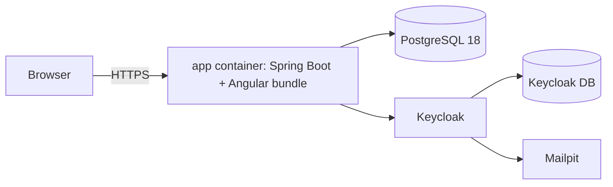

# 7. Deployment View

Repository layout, CI, delivery, images and local development follow the baseline: [../baseline/07-deployment-view](../baseline/07-deployment-view/README.md). Interim per REL-CD-08: [ADR 0004](../adr/0004-local-gates-and-compose-test-environment.md). Status: exercised in M1. The application image builds with Buildpacks and the embedded bundle (`./mvnw spring-boot:build-image -Dfrontend.dist=../frontend/dist/frontend/browser`), and `docker compose --profile auth --profile mail -f compose.yaml -f compose.app.yaml up -d --wait` starts PostgreSQL, Keycloak, Mailpit and the app; `GET /` answers 200 `text/html` and `GET /config.json` 200 against that image (REL-FE-06, first part). The real-backend E2E tier runs against this stack (chapter 10). The local installation sets a 120/min login-start limit (`APP_RATE_LIMITS_LOGIN_START_PER_MINUTE`) because the tests log in from one address; the application default is 10/min.

## 7.1 Infrastructure

Local Docker Compose is the only environment (ADR 0004): `backend/compose.yaml` (PostgreSQL, Keycloak, Mailpit) and `backend/compose.app.yaml` (adds the app image built from the same commit, SPRING-DEV-10).

## 7.2 Environments

| Environment | Purpose | Deployed by | Notes |
|---|---|---|---|
| local (Compose, demo profile) | development and the internal test installation | developer: `docker compose up` | demo seed data (fictitious) |
| test / staging / production | not applicable now | | trigger: hosted environment chosen |

## 7.3 Delivery platform mapping

| Capability | Baseline rule | This product |
|---|---|---|
| SCM host, branch protection | REL-BR-02, REL-BR-05 | not applicable: local git, no remote. Trigger: SCM host chosen |
| CI system | REPO-CI-01..03 | not applicable; local `verify` scripts are the gate |
| Container registry | REL-CD-01 | not applicable; local images |
| Image build | REL-IMG-02, SPRING-LIB-13 | Buildpacks (`spring-boot:build-image`) |
| Image scanner | SEC-CI-06 | not applicable yet; run `trivy` locally if installed (logged) |
| Dependency, secret, SAST scanners | SEC-CI-01 | SpotBugs+FindSecBugs in `verify`; `npm audit`; others not applicable |
| SBOM, provenance | SEC-CI-03/07 | CycloneDX in `verify`; signing not applicable |
| Dependency updates | TS-TOOL-15 | manual; trigger: SCM host |
| Runtime platform | REL-RUN-* | Docker Compose, single instance (accepted downtime) |
| Secret store | CFG-05, SPRING-CFG-07 | mounted files from `backend/dev/secrets/` (local, fictitious, gitignored; generated by a Compose init step) |
| Production approval | REL-CD-03 | not applicable |
| Migration variant | REL-DB-01 | start-up migration with own Flyway credentials |
| Probes | OBS-19, SPRING-OBS-01 | (a): `/livez`, `/readyz` on the main port |
| Termination grace | OBS-04 | Compose `stop_grace_period` above the shutdown budget (to be set in M0) |
| Log/metric export | SPRING-LIB-10 | structured stdout logs; OTLP not wired (none available) |
| Frontend delivery | REL-FE-01 | bundle embedded in the backend image (SPRING-REL-08) |

## 7.4 Configuration keys and secret sources

| Component | Key list | Secret source |
|---|---|---|
| backend | `backend/configuration-keys.yaml`  | mounted files, local dev only |

## 7.5 Rollout, availability and recovery

Single instance, no rolling deployment (internal test, data may be lost: 05 §5). RPO/RTO: not applicable for the internal release. Rollback drill: not applicable.

## 7.6 Timeouts and capacity

Ladder (RES-TMO-04): gateway 15 s > request 10 s > transaction 5 s > statement 3 s. Outbound: Keycloak admin API connect 2 s / read 5 s, one attempt for deletes. Database pool: 1 instance × 10 + reserve, limit 100.
