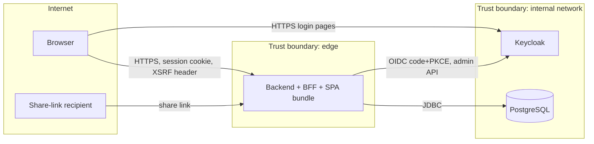

# Threat Model

- **Last review:** 2026-11-23, implementing agent (initial)
- **Next review due:** 2027-02-23

## 1. What are we working on?

| Trust boundary | Crossed by | Authentication | Data classes |
|---|---|---|---|
| Internet → edge | HTTPS | OIDC-based session cookie; share-link lookup unauthenticated | personal, confidential |
| Edge → database | JDBC, DML role | credentials from mounted files | personal, confidential |
| Edge → Keycloak | OIDC, admin REST | confidential client (`client_secret` from file) / service account | personal |

Public entry points of the API (SEC-TM-02, M4): exactly two, `POST /api/v1/invitations/lookup` (answers the list name for a valid token) and `POST /api/v1/invitations` (remembers a valid token in a session). Both take the token in the body, are rate limited per address, keep CSRF protection on, answer a wrong, renewed or malformed token with the same `404 SHARE_LINK_INVALID`, and reveal nothing but the list name. A third, `POST /api/v1/memberships/join`, needs a login. All other API paths need a session.

Entry points: `/api/v1/**`, `/oauth2/**`, `/login/oauth2/code/**`, `/logout`, back-channel logout endpoint, `/livez`/`/readyz`, static bundle, Keycloak pages.

## 2. What can go wrong?

| # | Threat | Element | Top 10:2025 | L | I |
|---|---|---|---|---|---|
| T1 | A user reads/changes another list by guessing ids | REST API | A01 | med | high |
| T2 | Guessing or leaking a share token grants membership | `/j/{token}`, logs, Referer | A01, A02 | low | high |
| T3 | Brute force or enumeration of accounts | Keycloak login/reset/register | A07 | high | med |
| T4 | CSRF on state-changing requests | BFF | A01 | med | med |
| T5 | Stored XSS through list/item/display names | SPA | A05 | med | high |
| T6 | Session theft or fixation | session cookie | A07 | low | high |
| T7 | Join-link brute force / abuse | `POST /v1/memberships/join`, `/invitations/lookup` | A06 | med | med |
| T8 | Resource exhaustion (huge lists, many lists, polling storm) | API | A06 | med | med |
| T9 | Account deletion leaves data or lets someone else delete | delete flow | A01 | low | high |
| T10 | Secrets or tokens in logs | all | A09 | med | high |
| T11 | Open redirect after login | BFF success handler | A01 | low | med |

## 3. What will we do about it?

| Threat | Mitigation | Rule IDs / ASVS | Test | Status |
|---|---|---|---|---|
| T1 | Membership check in every use case, 404 for non-members | SPRING-SEC-16/36, ASVS V8 | cross-user tests per use case (tag `cross-user`); `ListsApiIT` (real chain + PostgreSQL: B cannot read/rename/delete/leave A's list, answer identical to an unknown id); audit event `access.refused` | lists done (M2); items done (M3: `ItemsApiIT` runs all five item operations as B against A's list and compares each answer with the one for an unknown list; `@Tag("cross-user")` tests per item use case) |
| T2 | 256-bit CSPRNG token, uniform 404, rate limit, `Referrer-Policy: no-referrer`, masked paths | SEC-CRY-05, NFR-SEC-05/09, ADR 0008 | token entropy/shape test, log assertion | M4 |
| T3 | Keycloak brute-force detection (5 failures / 15 min, plus a quick-login check: failures less than a second apart lock after two), generic error for unknown account and wrong password | SPRING-SEC-21, ASVS V6/V7 | real-backend E2E (`@real`): generic message equal, lockout text, correct password refused while locked | done in M1. Known deviations: the „Zu viele Versuche“ text reveals that the account exists once it is locked (required by FR-AUTH-02 AC4); a newer reset link does not invalidate older ones (FR-AUTH-04 AC3 not met; each link is single use and expires after 60 minutes) |
| T4 | `csrf.spa()`, `X-XSRF-TOKEN`, `SameSite=Lax` | SPRING-SEC-24/25, ASVS V3 | web slice tests 403 without CSRF | M1 |
| T5 | Angular interpolation only, no `innerHTML`, strict nonce CSP | NG-SEC-01..06, NFR-SEC-07 | component test with `<script>` text, CSP E2E | M3 |
| T6 | HttpOnly SameSite=Lax cookie (`Secure`/`__Host-` outside the local installation), session rotation on login, lifetimes ([ADR 0002](../adr/0002-bff-in-backend-and-keycloak-idp.md)); anonymous API calls create no session | SPRING-SEC-24/32/37 | real tier: pre-login session id rejected after login, cookie flags and 30-day lifetime, other sessions ended after a password reset; backend test: anonymous call creates no session | done in M1 |
| T7 | Bucket4j: invitation calls per address, join per address and per person | SPRING-SEC-21 | `SharingRateLimitTest` (429, Retry-After, other address/person unaffected) | M4 |
| T8 | limits BR-12, bounded queries, 304 polling (ETag = list revision; the 304 path reads one row; a stranger with a guessed revision gets the same 404 as for an unknown list, `ItemsSyncApiIT`); no server session for anonymous API calls, **one deliberate exception (M4):** `POST /v1/invitations` opens a visitor session, but only for a valid token, at most 30 per minute and address, for 2 hours, purged by the Spring Session cleanup | API-N1-07, SPRING-SEC-15 | limit tests (M2/M3/M5); `MeControllerTest.anAnonymousCallCreatesNoServerSideSession`; `ListRulesConcurrencyIT` (100-list limit under concurrency), `ListSummaryJdbcAdapterIT` (`LIMIT 100`, one statement) | lists done (M2), items done (M3: `ItemRulesConcurrencyIT` 500-item limit under concurrency, `ItemPersistenceAdapterIT` `LIMIT 500`, text limits in `ItemTextTest`, ≤500 ids in `clear-checked`), polling M5 |
| T9 | Re-authentication at IdP, single transaction, session invalidation | ADR 0003, DP-DSR-01 | integration test | M6 |
| T10 | No bodies logged; secret type; log tests | SPRING-LOG-08, SPRING-CFG-11, SPRING-DP-07 | log capture tests | M1/M4 |
| T11 | Redirect targets allow-listed to internal paths; after a login that started at an invitation the redirect is the constant `/j/consume` (no token in any URL) | TS-SEC-03 | `InternalPaths` unit test, `BffLoginFlowTest` | M4 |

Accepted risks: [exceptions.md](exceptions.md). OQ-1 (no e-mail verification) is accepted in the requirements.

## 4. Did we do a good job?

Initial model before code; to be updated at every milestone that adds an entry point.

## 5. Sharing and joining (M4)

| Risk | Decision | Evidence |
|---|---|---|
| Token guessing (T2) | 256 bits from `SecureRandom`; format check in the domain turns any malformed value into the uniform 404 instead of a 400; the database refuses a malformed value (`lists_share_token_format`) and a duplicate (`lists_share_token_key`) | `ShareTokenTest`, `ShareLinkJdbcAdapterIT`, `SharingApiIT.everyWrongTokenGetsTheSameAnswerWhateverItLooksLike` |
| Token in logs, audit events, errors (T10) | `ShareToken.toString()` is redacted; the token travels only in request bodies and in the link the member copies; audit events carry only the pseudonymous user id (`list.joined`, `share-link.renewed`, `share-link.refused`); the log capture of two whole flows contains no token | `SharingApiIT` (`CapturedOutput`), `ShareTokenTest` |
| Old link still works after renewal (BR-06) | renewal and join take the same list row lock; the join looks the list up by token under that lock, so a join racing a renewal either happened first or finds nothing | `ShareRulesConcurrencyIT`, `SharingApiIT.joiningWorksOnceAndARenewalKillsTheOldLinkForEverybodyAtOnce` |
| Member limit raced (BR-12) | lock the list row before counting; two people taking the 50th place at once: exactly one gets in | `ShareRulesConcurrencyIT` (mutation-checked: without the list-row lock it fails) |
| Anonymous session creation (T8) | only for a valid token, 30 per minute and address, 2 hours, restored to the normal idle time at login | `InvitationControllerTest.aWrongTokenCreatesNoSession`, `SharingRateLimitTest` |
| Token stored as shown, not hashed | the link must be reproducible for every member; a database read gives the same power as the lists themselves for the people holding it. Accepted; the token is not in any read model, log or export | ADR 0008 |

