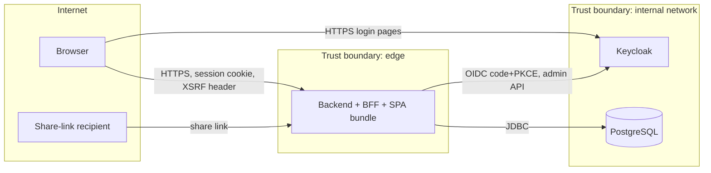

# Threat Model

- **Last review:** 2026-11-23, implementing agent (initial)
- **Next review due:** 2027-02-23

## 1. What are we working on?

| Trust boundary | Crossed by | Authentication | Data classes |
|---|---|---|---|
| Internet → edge | HTTPS | OIDC-based session cookie; share-link lookup unauthenticated | personal, confidential |
| Edge → database | JDBC, DML role | credentials from mounted files | personal, confidential |
| Edge → Keycloak | OIDC, admin REST | confidential client (`client_secret` from file) / service account | personal |

Entry points: `/api/v1/**`, `/oauth2/**`, `/login/oauth2/code/**`, `/logout`, back-channel logout endpoint, `/livez`/`/readyz`, static bundle, Keycloak pages.

## 2. What can go wrong?

| # | Threat | Element | Top 10:2025 | L | I |
|---|---|---|---|---|---|
| T1 | A user reads/changes another list by guessing ids | REST API | A01 | med | high |
| T2 | Guessing or leaking a share token grants membership | `/j/{token}`, logs, Referer | A01, A02 | low | high |
| T3 | Brute force or enumeration of accounts | Keycloak login/reset/register | A07 | high | med |
| T4 | CSRF on state-changing requests | BFF | A01 | med | med |
| T5 | Stored XSS through list/item/display names | SPA | A05 | med | high |
| T6 | Session theft or fixation | session cookie | A07 | low | high |
| T7 | Join-link brute force / abuse | `POST /v1/memberships/join`, `/invitations/lookup` | A06 | med | med |
| T8 | Resource exhaustion (huge lists, many lists, polling storm) | API | A06 | med | med |
| T9 | Account deletion leaves data or lets someone else delete | delete flow | A01 | low | high |
| T10 | Secrets or tokens in logs | all | A09 | med | high |
| T11 | Open redirect after login | BFF success handler | A01 | low | med |

## 3. What will we do about it?

| Threat | Mitigation | Rule IDs / ASVS | Test | Status |
|---|---|---|---|---|
| T1 | Membership check in every use case, 404 for non-members | SPRING-SEC-16/36, ASVS V8 | cross-user tests per use case (tag `cross-user`); `ListsApiIT` (real chain + PostgreSQL: B cannot read/rename/delete/leave A's list, answer identical to an unknown id); audit event `access.refused` | lists done (M2); items M3 |
| T2 | 256-bit CSPRNG token, uniform 404, rate limit, `Referrer-Policy: no-referrer`, masked paths | SEC-CRY-05, NFR-SEC-05/09, ADR 0008 | token entropy/shape test, log assertion | M4 |
| T3 | Keycloak brute-force detection (5 failures / 15 min, plus a quick-login check: failures less than a second apart lock after two), generic error for unknown account and wrong password | SPRING-SEC-21, ASVS V6/V7 | real-backend E2E (`@real`): generic message equal, lockout text, correct password refused while locked | done in M1. Known deviations: the „Zu viele Versuche“ text reveals that the account exists once it is locked (required by FR-AUTH-02 AC4); a newer reset link does not invalidate older ones (FR-AUTH-04 AC3 not met; each link is single use and expires after 60 minutes) |
| T4 | `csrf.spa()`, `X-XSRF-TOKEN`, `SameSite=Lax` | SPRING-SEC-24/25, ASVS V3 | web slice tests 403 without CSRF | M1 |
| T5 | Angular interpolation only, no `innerHTML`, strict nonce CSP | NG-SEC-01..06, NFR-SEC-07 | component test with `<script>` text, CSP E2E | M3 |
| T6 | HttpOnly SameSite=Lax cookie (`Secure`/`__Host-` outside the local installation), session rotation on login, lifetimes ([ADR 0002](../adr/0002-bff-in-backend-and-keycloak-idp.md)); anonymous API calls create no session | SPRING-SEC-24/32/37 | real tier: pre-login session id rejected after login, cookie flags and 30-day lifetime, other sessions ended after a password reset; backend test: anonymous call creates no session | done in M1 |
| T7 | Bucket4j per user and IP | SPRING-SEC-21 | 429 test | M4 |
| T8 | limits BR-12, bounded queries, 304 polling; no server session for anonymous API calls | API-N1-07, SPRING-SEC-15 | limit tests (M2/M3/M5); `MeControllerTest.anAnonymousCallCreatesNoServerSideSession`; `ListRulesConcurrencyIT` (100-list limit under concurrency), `ListSummaryJdbcAdapterIT` (`LIMIT 100`, one statement) | lists done (M2), items M3, polling M5 |
| T9 | Re-authentication at IdP, single transaction, session invalidation | ADR 0003, DP-DSR-01 | integration test | M6 |
| T10 | No bodies logged; secret type; log tests | SPRING-LOG-08, SPRING-CFG-11, SPRING-DP-07 | log capture tests | M1/M4 |
| T11 | Redirect targets allow-listed to internal paths | TS-SEC-03 | unit test | M4 |

Accepted risks: [exceptions.md](exceptions.md). OQ-1 (no e-mail verification) is accepted in the requirements.

## 4. Did we do a good job?

Initial model before code; to be updated at every milestone that adds an entry point.
